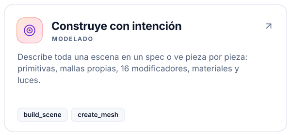
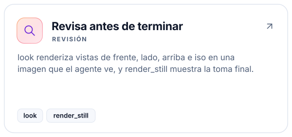
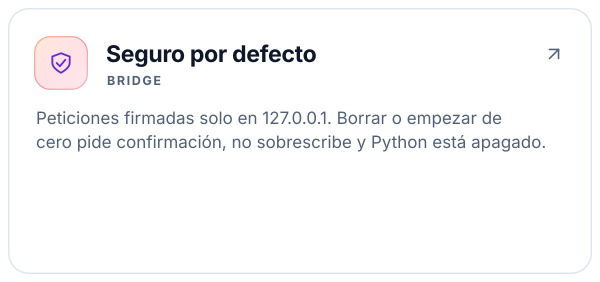
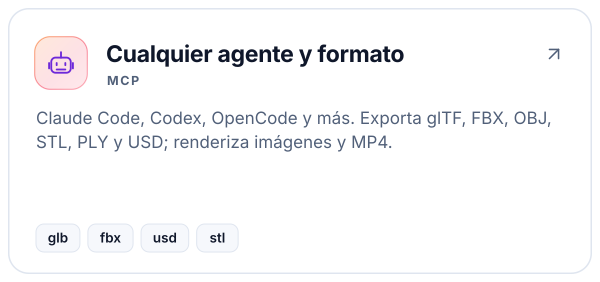
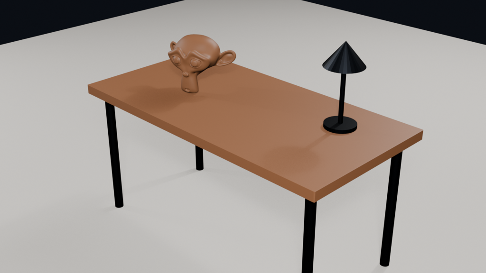
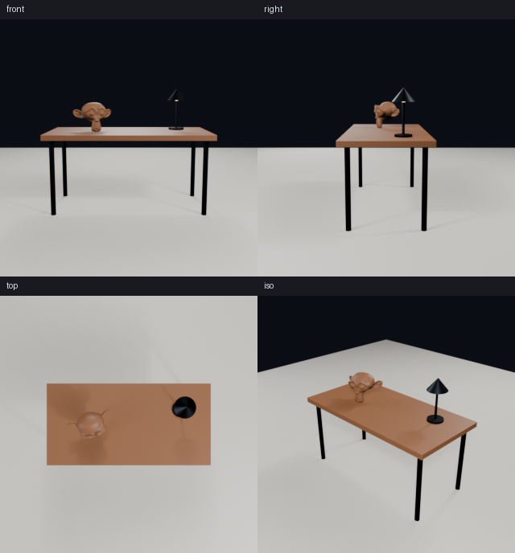

<a id="top"></a>

<!-- kit:hero -->
<p align="center"><picture><source media="(prefers-color-scheme: dark)" srcset="assets/readme-builder/kit/hero-es-dark.svg" /></picture></p>
<!-- /kit:hero -->

<p align="center"><b>Modela, ilumina, renderiza, anima y exporta en Blender desde tu agente, y deja que revise el resultado.</b></p>

<!-- kit:nav -->
<p align="center"><a href="#-inicio-rápido"><picture><source media="(prefers-color-scheme: dark)" srcset="assets/readme-builder/kit/nav-es-01-dark.svg" /></picture></a>&nbsp;
<a href="#-instalación-retirada-y-compatibilidad"><picture><source media="(prefers-color-scheme: dark)" srcset="assets/readme-builder/kit/nav-es-02-dark.svg" /></picture></a>&nbsp;
<a href="#-herramientas"><picture><source media="(prefers-color-scheme: dark)" srcset="assets/readme-builder/kit/nav-es-03-dark.svg" /></picture></a>&nbsp;
<a href="#-cómo-funciona"><picture><source media="(prefers-color-scheme: dark)" srcset="assets/readme-builder/kit/nav-es-04-dark.svg" /></picture></a>&nbsp;
<a href="README.md"><picture><source media="(prefers-color-scheme: dark)" srcset="assets/readme-builder/kit/nav-es-05-dark.svg" /></picture></a></p>
<!-- /kit:nav -->

<!-- kit:facts -->
<p align="center"><picture><source media="(prefers-color-scheme: dark)" srcset="assets/readme-builder/kit/facts-es-dark.svg" /></picture></p>
<!-- /kit:facts -->

<a id="-por-qué"></a>
##  Por qué blender-forge

blender-forge es un servidor MCP más una extensión pequeña para Blender. Tu agente describe lo que quiere,
Blender lo construye en su hilo principal y el agente recibe imágenes para corregir lo que se vea mal.

<!-- kit:why -->
<p align="center"><a href="#-herramientas"><picture><source media="(prefers-color-scheme: dark)" srcset="assets/readme-builder/kit/why-es-01-dark.svg" /></picture></a><a href="#-cómo-funciona"><picture><source media="(prefers-color-scheme: dark)" srcset="assets/readme-builder/kit/why-es-02-dark.svg" /></picture></a><a href="#-cómo-funciona"><picture><source media="(prefers-color-scheme: dark)" srcset="assets/readme-builder/kit/why-es-03-dark.svg" /></picture></a><a href="#-instalación-retirada-y-compatibilidad"><picture><source media="(prefers-color-scheme: dark)" srcset="assets/readme-builder/kit/why-es-04-dark.svg" /></picture></a></p>
<!-- /kit:why -->

<p align="center"></p>
<p align="center"><sub>Hecho desde <a href="examples/desk.json">examples/desk.json</a> con una sola llamada a <code>build_scene</code> y renderizado con Eevee. Abajo, la hoja de vistas que <code>look</code> le regresa al agente.</sub></p>
<p align="center"></p>

<p align="center"></p>

<a id="-inicio-rápido"></a>
##  Inicio rápido

Necesitas [Blender](https://www.blender.org/download/) 4.2 o más nuevo (probado en 5.2.3 LTS) y
[uv](https://docs.astral.sh/uv/).

```sh
git clone https://github.com/robgallardof/blender-forge.git
cd blender-forge/mcp/blender-forge
uv sync
uv run blender-forge-install          # compila y activa la extensión, crea el token del bridge
cd ../..
python scripts/install-mcp.py --with-skills   # registra el servidor en tus agentes (ver abajo)
```

Abre Blender (el bridge arranca con él) o sáltatelo: el agente puede llamar `start_headless` para correr
Blender en segundo plano. Luego pídele a tu agente:

> *"Haz un escritorio low-poly con lámpara, ilumínalo y enséñamelo"* · *"Conviértelo en un turntable de
> 10 segundos"* · *"Exporta la silla en .glb para web"* · *"Busca un HDRI de estudio CC0 y úsalo"*

<p align="center"></p>

<a id="-instalación-retirada-y-compatibilidad"></a>
##  Instalación, retirada y compatibilidad

Es un **servidor MCP stdio** estándar. También expone las skills como recursos (`skill://<nombre>`) y el rol
`3d-artist` como prompt, así cualquier cliente recibe el manual.

| Cliente | `--clients` | Archivo que edita | Alcance |
|---|---|---|---|
| Claude Code | `claude-code` | `claude mcp --scope user` (+ skills en `~/.claude` con `--with-skills`) | usuario |
| Codex | `codex` | `~/.codex/config.toml` | usuario |
| OpenCode 1.x | `opencode` | `opencode.json` | proyecto |
| DeepSeek Harness | `deepseek` | `.dsh/mcp.cordis.yml` | proyecto |
| Gemini CLI | `gemini-cli` | `~/.gemini/settings.json` | usuario |
| Antigravity | `antigravity` | `~/.gemini/antigravity/mcp_config.json` | usuario |
| Cursor | `cursor` | `~/.cursor/mcp.json` | usuario |
| VS Code | `vscode` | `Code/User/mcp.json` | usuario |
| Windsurf · Claude Desktop | `windsurf` · `claude-desktop` | su archivo de configuración MCP | usuario |

```sh
python scripts/install-mcp.py --list                  # qué clientes tienes
python scripts/install-mcp.py --dry-run               # muestra cada cambio, no escribe nada
python scripts/install-mcp.py --clients claude-code   # solo algunos clientes
python scripts/install-mcp.py --remove                # deshacer (cada archivo editado guarda un .bak)
uv run blender-forge-install --check                  # estado de la extensión, el token y el bridge
uv run blender-forge-install --remove                 # desinstala la extensión de Blender
```

### Docker (opcional)

El contenedor solo corre el servidor MCP; Blender sigue en tu equipo con su bridge en loopback. Monta tu
carpeta de trabajo en `/work` y el servidor traduce las rutas en ambos sentidos, así los renders y exports
quedan ahí.

```sh
docker build -t blender-forge:local .
export BLENDER_FORGE_MCP_TOKEN="$(python -c 'import secrets; print(secrets.token_hex(32))')"
FORGE_WORK=C:/Users/me/3d docker compose up -d --build --wait      # HTTP en 127.0.0.1:8080/mcp con token
```

Configuración stdio para clientes MCP, red en Linux y todas las variables: [docs/DOCKER.md](docs/DOCKER.md).

**Qué se probó:** un cliente MCP real por stdio lista las herramientas, recursos y prompts; la extensión se
compila, instala y activa con la CLI `extension` de Blender en una carpeta de usuario aislada y su bridge
responde; cada operación corre contra un Blender 5.2.3 real en segundo plano. La inferencia del modelo dentro
de cada agente no forma parte de las pruebas automáticas.

<p align="center"></p>

<a id="-herramientas"></a>
##  Herramientas

<!-- kit:tools -->
<p align="center"><picture><source media="(prefers-color-scheme: dark)" srcset="assets/readme-builder/kit/tools-es-dark.svg" /></picture></p>
<!-- /kit:tools -->

Convenciones: Z hacia arriba, metros, rotaciones en grados, colores `#RRGGBB`. `delete` y `new_scene`
necesitan `confirm=true`; `save` guarda una copia salvo que pases `overwrite=true`. `run_python` existe para
lo que las herramientas no cubren y sigue apagado salvo que instales con `--allow-python`.

<!-- kit:links -->
<p align="center"><a href="examples/desk.json"><picture><source media="(prefers-color-scheme: dark)" srcset="assets/readme-builder/kit/links-es-01-dark.svg" /></picture></a>&nbsp;
<a href="docs/DOCKER.md"><picture><source media="(prefers-color-scheme: dark)" srcset="assets/readme-builder/kit/links-es-02-dark.svg" /></picture></a>&nbsp;
<a href=".agents/skills"><picture><source media="(prefers-color-scheme: dark)" srcset="assets/readme-builder/kit/links-es-03-dark.svg" /></picture></a>&nbsp;
<a href="AGENTS.md"><picture><source media="(prefers-color-scheme: dark)" srcset="assets/readme-builder/kit/links-es-04-dark.svg" /></picture></a></p>
<!-- /kit:links -->

<p align="center"></p>

<a id="-cómo-funciona"></a>
##  Cómo funciona

<p align="center"><picture><source media="(prefers-color-scheme: dark)" srcset="assets/readme/diagrams/how-it-works-es-dark.svg" /></picture></p>

- **Bridge:** la extensión escucha solo en `127.0.0.1`. Cada petición va firmada con HMAC-SHA256 usando un
  token en `~/.config/blender-forge/bridge.json`, lleva hora y un nonce de un solo uso, y nombra una operación
  de una lista permitida. Todo lo demás se rechaza antes de que Blender lo vea.
- **Hilo principal:** las peticiones se encolan y las ejecuta un timer de Blender (o el bucle principal en
  modo headless), así la API de Blender nunca se llama desde otro hilo.
- **Revisión:** `look` agrega una cámara temporal, renderiza las vistas pedidas, deja la escena como estaba y
  regresa una sola hoja. Ignora los pisos al encuadrar para que el objeto llene la toma.
- **Assets:** `search_assets` e `import_asset` usan la API pública de Poly Haven (CC0). Los archivos se
  guardan en `~/.cache/blender-forge`; los objetos importados conservan la propiedad `forge_credit`.

<p align="center"></p>

<a id="-desarrollo"></a>
##  Desarrollo

```sh
cd mcp/blender-forge
uv run pytest                    # protocolo, spec, MCP por stdio, Blender real headless, instalación
uv run pytest -m network         # búsqueda e importación en Poly Haven (necesita internet)
```

Blender se busca en el `PATH`, en las carpetas de instalación habituales o con `BLENDER_FORGE_BLENDER`. La CI
corre las pruebas unitarias en Windows, macOS y Linux, y las de Blender en Linux con Blender 5.2.3 (checksum
verificado). Estructura y reglas para quien contribuye y para agentes: [AGENTS.md](AGENTS.md).

**Todavía no cubre:** esculpido, rigging, desenvolver UV, geometry nodes y la captura del viewport (las
revisiones usan renders). Para eso usa `run_python` si lo activas.

<p align="center"></p>

<a id="-licencia"></a>
##  Licencia

[MIT](LICENSE) © Roberto Gallardo. No está afiliado a la Blender Foundation. Los assets de Poly Haven son CC0.

<!-- kit:top -->
<p align="center"><a href="#top"><picture><source media="(prefers-color-scheme: dark)" srcset="assets/readme-builder/kit/top-es-01-dark.svg" /></picture></a></p>
<!-- /kit:top -->
