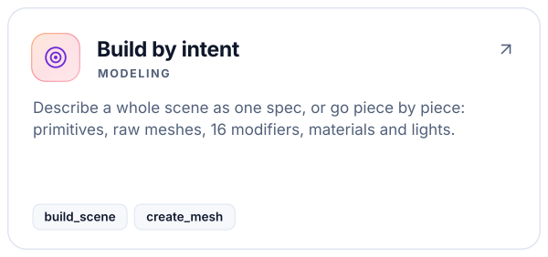
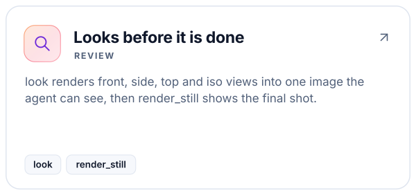
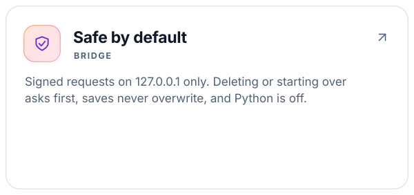
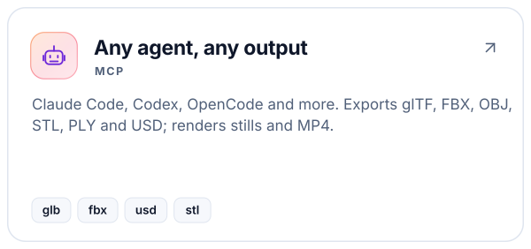

<a id="top"></a>

<!-- kit:hero -->
<p align="center"><picture><source media="(prefers-color-scheme: dark)" srcset="assets/readme-builder/kit/hero-en-dark.svg" /></picture></p>
<!-- /kit:hero -->

<p align="center"><b>Model, light, render, animate and export in Blender from your agent, and let it look at the result.</b></p>

<!-- kit:nav -->
<p align="center"><a href="#-quick-start"><picture><source media="(prefers-color-scheme: dark)" srcset="assets/readme-builder/kit/nav-en-01-dark.svg" /></picture></a>&nbsp;
<a href="#-agent-setup-removal-and-compatibility"><picture><source media="(prefers-color-scheme: dark)" srcset="assets/readme-builder/kit/nav-en-02-dark.svg" /></picture></a>&nbsp;
<a href="#-tools"><picture><source media="(prefers-color-scheme: dark)" srcset="assets/readme-builder/kit/nav-en-03-dark.svg" /></picture></a>&nbsp;
<a href="#-how-it-works"><picture><source media="(prefers-color-scheme: dark)" srcset="assets/readme-builder/kit/nav-en-04-dark.svg" /></picture></a>&nbsp;
<a href="README.es.md"><picture><source media="(prefers-color-scheme: dark)" srcset="assets/readme-builder/kit/nav-en-05-dark.svg" /></picture></a></p>
<!-- /kit:nav -->

<!-- kit:facts -->
<p align="center"><picture><source media="(prefers-color-scheme: dark)" srcset="assets/readme-builder/kit/facts-en-dark.svg" /></picture></p>
<!-- /kit:facts -->

<a id="-why"></a>
##  Why blender-forge

blender-forge is an MCP server plus a small Blender extension. Your agent describes what it wants; Blender
builds it on its main thread; the agent gets images back and fixes what looks wrong.

<!-- kit:why -->
<p align="center"><a href="#-tools"><picture><source media="(prefers-color-scheme: dark)" srcset="assets/readme-builder/kit/why-en-01-dark.svg" /></picture></a><a href="#-how-it-works"><picture><source media="(prefers-color-scheme: dark)" srcset="assets/readme-builder/kit/why-en-02-dark.svg" /></picture></a><a href="#-how-it-works"><picture><source media="(prefers-color-scheme: dark)" srcset="assets/readme-builder/kit/why-en-03-dark.svg" /></picture></a><a href="#-agent-setup-removal-and-compatibility"><picture><source media="(prefers-color-scheme: dark)" srcset="assets/readme-builder/kit/why-en-04-dark.svg" /></picture></a></p>
<!-- /kit:why -->

<p align="center"></p>
<p align="center"><sub>Built from <a href="examples/desk.json">examples/desk.json</a> with one <code>build_scene</code> call and rendered with Eevee. Below, the contact sheet <code>look</code> returns to the agent.</sub></p>
<p align="center"></p>

<p align="center"></p>

<a id="-quick-start"></a>
##  Quick start

Requires [Blender](https://www.blender.org/download/) 4.2 or newer (tested on 5.2.3 LTS) and
[uv](https://docs.astral.sh/uv/).

```sh
git clone https://github.com/robgallardof/blender-forge.git
cd blender-forge/mcp/blender-forge
uv sync
uv run blender-forge-install          # builds and enables the extension, creates the bridge token
cd ../..
python scripts/install-mcp.py --with-skills   # registers the server in your agents (see below)
```

Open Blender (the bridge starts with it), or skip that: the agent can call `start_headless` to run Blender
in the background. Then ask your agent:

> *"Build a low-poly desk with a lamp, light it and show me"* · *"Turn this into a 10-second turntable"* ·
> *"Export the chair as .glb for the web"* · *"Find a CC0 studio HDRI and use it"*

<p align="center"></p>

<a id="-agent-setup-removal-and-compatibility"></a>
##  Agent setup, removal and compatibility

The server is a standard **stdio MCP server**. It also exposes the skills as resources (`skill://<name>`)
and the `3d-artist` role as a prompt, so any client gets the playbook.

| Client | `--clients` | File it edits | Scope |
|---|---|---|---|
| Claude Code | `claude-code` | `claude mcp --scope user` (+ skills in `~/.claude` with `--with-skills`) | user |
| Codex | `codex` | `~/.codex/config.toml` | user |
| OpenCode 1.x | `opencode` | `opencode.json` | project |
| DeepSeek Harness | `deepseek` | `.dsh/mcp.cordis.yml` | project |
| Gemini CLI | `gemini-cli` | `~/.gemini/settings.json` | user |
| Antigravity | `antigravity` | `~/.gemini/antigravity/mcp_config.json` | user |
| Cursor | `cursor` | `~/.cursor/mcp.json` | user |
| VS Code | `vscode` | `Code/User/mcp.json` | user |
| Windsurf · Claude Desktop | `windsurf` · `claude-desktop` | their MCP config file | user |

```sh
python scripts/install-mcp.py --list                  # which clients you have
python scripts/install-mcp.py --dry-run               # show every change, write nothing
python scripts/install-mcp.py --clients claude-code   # only some clients
python scripts/install-mcp.py --remove                # undo (each edited file keeps a .bak)
uv run blender-forge-install --check                  # extension, token and bridge state
uv run blender-forge-install --remove                 # uninstall the Blender extension
```

### Docker (optional)

The container runs only the MCP server; Blender stays on your machine with its loopback bridge. Mount your
work folder at `/work` and the server translates paths both ways, so renders and exports land in it.

```sh
docker build -t blender-forge:local .
export BLENDER_FORGE_MCP_TOKEN="$(python -c 'import secrets; print(secrets.token_hex(32))')"
FORGE_WORK=C:/Users/me/3d docker compose up -d --build --wait      # HTTP on 127.0.0.1:8080/mcp with a token
```

stdio setup for MCP clients, Linux networking and every variable: [docs/DOCKER.md](docs/DOCKER.md).

**What was tested:** a real MCP stdio client lists the tools, resources and prompts; the extension is
built, installed and enabled with Blender's own `extension` CLI in an isolated user folder and its bridge
answers; every operation runs against a real headless Blender 5.2.3. Model inference inside each agent is
not part of the automated tests.

<p align="center"></p>

<a id="-tools"></a>
##  Tools

<!-- kit:tools -->
<p align="center"><picture><source media="(prefers-color-scheme: dark)" srcset="assets/readme-builder/kit/tools-en-dark.svg" /></picture></p>
<!-- /kit:tools -->

Conventions: Z up, metres, rotations in degrees, colours as `#RRGGBB`. `delete` and `new_scene` need
`confirm=true`; `save` writes a copy unless you pass `overwrite=true`. `run_python` exists for what the tools
do not cover and stays off unless you install with `--allow-python`.

<!-- kit:links -->
<p align="center"><a href="examples/desk.json"><picture><source media="(prefers-color-scheme: dark)" srcset="assets/readme-builder/kit/links-en-01-dark.svg" /></picture></a>&nbsp;
<a href="docs/DOCKER.md"><picture><source media="(prefers-color-scheme: dark)" srcset="assets/readme-builder/kit/links-en-02-dark.svg" /></picture></a>&nbsp;
<a href=".agents/skills"><picture><source media="(prefers-color-scheme: dark)" srcset="assets/readme-builder/kit/links-en-03-dark.svg" /></picture></a>&nbsp;
<a href="AGENTS.md"><picture><source media="(prefers-color-scheme: dark)" srcset="assets/readme-builder/kit/links-en-04-dark.svg" /></picture></a></p>
<!-- /kit:links -->

<p align="center"></p>

<a id="-how-it-works"></a>
##  How it works

<p align="center"><picture><source media="(prefers-color-scheme: dark)" srcset="assets/readme/diagrams/how-it-works-en-dark.svg" /></picture></p>

- **Bridge:** the extension listens on `127.0.0.1` only. Every request is signed with HMAC-SHA256 using a
  token in `~/.config/blender-forge/bridge.json`, carries a timestamp and a single-use nonce, and names one
  operation from an explicit allowlist. Anything else is refused before Blender sees it.
- **Main thread:** requests are queued and run by a Blender timer (or by the main loop in headless mode),
  so Blender's API is never called from another thread.
- **Review:** `look` adds a temporary camera, renders the views you ask for, restores the scene and returns
  one contact sheet. Floors are ignored when framing so the subject fills the shot.
- **Assets:** `search_assets` and `import_asset` use Poly Haven's public API (CC0). Files are cached in
  `~/.cache/blender-forge`; imported objects keep a `forge_credit` property.

<p align="center"></p>

<a id="-development"></a>
##  Development

```sh
cd mcp/blender-forge
uv run pytest                    # protocol, spec, stdio MCP, real headless Blender, extension install
uv run pytest -m network         # Poly Haven search and import (needs internet)
```

Blender is found on `PATH`, in the usual install folders, or through `BLENDER_FORGE_BLENDER`. CI runs the
unit tests on Windows, macOS and Linux, and the Blender tests on Linux with Blender 5.2.3 (checksum
verified). Layout and rules for contributors and agents: [AGENTS.md](AGENTS.md).

**Not covered yet:** sculpting, rigging, UV unwrapping, geometry nodes and the viewport screenshot (reviews use
renders instead). Use `run_python` for those if you enable it.

<p align="center"></p>

<a id="-license"></a>
##  License

[MIT](LICENSE) © Roberto Gallardo. Not affiliated with the Blender Foundation. Poly Haven assets are CC0.

<!-- kit:top -->
<p align="center"><a href="#top"><picture><source media="(prefers-color-scheme: dark)" srcset="assets/readme-builder/kit/top-en-01-dark.svg" /></picture></a></p>
<!-- /kit:top -->
